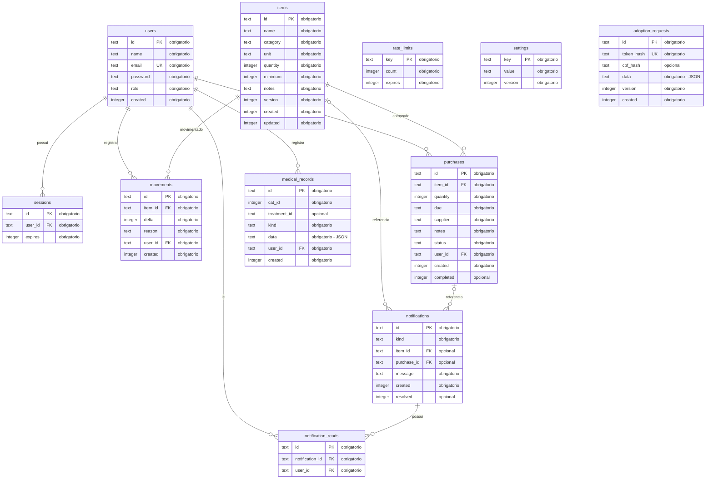

# Diagrama entidade-relacionamento — banco atual

Conferido em 27/09/2026 contra [schema.ts](../db/schema.ts) e as três migrações SQL em drizzle/. Representa as 11 tabelas da aplicação atual: SQLite local e D1 publicado.

## Modelo físico completo

## Como ler

- **PK**: chave primária. **FK**: chave estrangeira declarada. **UK**: campo com índice único.
- **||**: exatamente um; **o{**: zero ou muitos; **|o**: zero ou um.
- Cada sessão, movimentação, compra, registro médico e leitura pertence a um usuário.
- Uma notificação pode apontar para um item e/ou uma compra; ambas as referências são opcionais.
- O par user_id + notification_id também é único em notification_reads.
- As FKs usam NO ACTION: não há exclusão ou atualização em cascata declarada.

## Relacionamentos lógicos sem FK

| Informação | Armazenamento e vínculo |
| --- | --- |
| Gatos, vacinas e medicamentos antigos | settings.value, chave gatil: JSON com cats, vaccines e meds |
| Ficha de voluntário | settings.value, chave volunteer:ID; ID corresponde a users.id |
| Respostas, gato e etapa da candidatura | adoption_requests.data; campo cat referencia o gato do JSON |
| Gato do prontuário | medical_records.cat_id referencia o gato do JSON |
| Tratamento da aplicação/conclusão | medical_records.treatment_id referencia outro registro médico |

**Não existe tabela cats no banco atual.** Os vínculos acima não possuem chaves estrangeiras e não foram desenhados como relações físicas. adoption_requests não possui FK para users: a candidatura pode ser enviada sem conta interna. settings e rate_limits também não possuem FKs.

## Observações de manutenção

- password guarda hash da senha, não a senha em texto puro.
- cpf_hash é índice de busca; as respostas JSON também podem conter o CPF original.
- Quantidades de estoque usam milésimos: 2500 representa 2,5 unidades.
- version auxilia o controle de atualizações concorrentes.
- A tabela técnica local _local_migrations controla migrações e não integra o domínio da aplicação.
- Veja [Servidor e dados](02-servidor-e-dados.md) para regras, conteúdo JSON e demais índices.

[Arquivo Mermaid editável](05-diagrama-banco.mmd).
