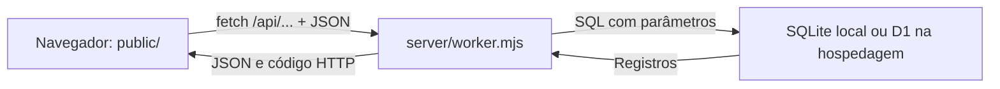

> Atualização de escopo em 7/10/2026: consulte [Alterações após a reunião](06-reuniao-e-implementacao.md). As descrições de estoque e permissões fixas nos guias anteriores são históricas.

# Peticas — guia técnico para entender e manter o sistema

**Base analisada:** código do commit `ecf7b2612d9fca326935c10d9e1af7ce33f7123d`, em 27/09/2026. A documentação foi criada depois desse commit. O endereço publicado foi posteriormente renomeado para `https://gatil-peticas.patrickalan2014.chatgpt.site` sem mudança no código.

Este guia descreve a implementação existente, incluindo suas limitações. Exemplos identificados como didáticos são explicações ou propostas, não funcionalidades que já existem. Não é necessário entender tudo de uma vez: acompanhe uma ação da tela até o banco e volte aos conceitos conforme precisar.

## Como estudar

1. Leia este arquivo para entender as peças e executar o projeto.
2. Leia [Interface e JavaScript](01-interface.md) com `public/index.html` e os quatro scripts abertos.
3. Leia [Servidor, API e banco](02-servidor-e-dados.md) para entender o que realmente salva e protege os dados.
4. Use [Manutenção e diagnóstico](03-manutencao.md) para alterar o sistema com segurança.
5. Consulte o [Índice do código](04-indice-do-codigo.md) para localizar funções e suas redefinições.

Uma primeira atividade prática: abra “Minha candidatura”, consulte um CPF fictício em um banco de teste e acompanhe a requisição na aba **Network/Rede** das ferramentas do navegador. Você verá onde terminam as responsabilidades da tela e começam as do servidor.

## 1. O sistema em três partes

O **frontend** é o que roda no navegador: HTML, CSS e JavaScript desenham telas, leem formulários e pedem informações ao servidor. O **backend** recebe essas solicitações, verifica permissões e executa as regras. O **banco de dados** guarda os registros entre uma visita e outra.



Exemplo: clicar em “Movimentar” abre um formulário. Salvar chama `saveMovement`, que usa `api` para fazer uma requisição HTTP. O servidor confere a sessão, a quantidade e a versão do item. Só então altera o saldo e acrescenta uma linha ao histórico. A tela busca o estoque novamente e o redesenha.

**Alterar uma variável no navegador não é salvar no banco. Ocultar um botão não é impedir uma ação na API.** Essas duas distinções explicam grande parte da arquitetura.

## 2. Tecnologias realmente utilizadas

| Tecnologia | Papel neste projeto |
| --- | --- |
| HTML | Estrutura inicial, referências aos arquivos, contêiner da aplicação e janela modal |
| CSS | Cores, layout, componentes e adaptação às larguras de tela |
| JavaScript no navegador | Templates HTML, navegação por `#`, formulários e chamadas HTTP |
| JavaScript ESM (`.mjs`) | Código do servidor, scripts de build e testes |
| Node.js 24 | Executa o servidor e SQLite locais, build e testes; a versão usada durante o desenvolvimento foi 24.19.0 |
| Cloudflare Worker | Executa o backend publicado por Sites; não é um processo Node permanente |
| SQLite / Cloudflare D1 | Banco relacional local / banco usado na hospedagem |
| `@noble/hashes` 1.8.0 | Implementação de scrypt para derivar hashes de senhas |
| `drizzle-orm` 0.44.5 | Expressa o esquema em `db/schema.ts`; as consultas do backend são SQL manual |
| `drizzle-kit` 0.31.4 | Gera migrações SQL a partir do esquema |
| `esbuild` 0.25.9 | Empacota o backend e suas dependências para o Worker |
| pnpm | Gerenciador das dependências; o lockfile registra a resolução delas |
| Sites | Guarda versões de código/pacotes e publica o site e suas migrações |

Não há React, Vue, Next.js, Express ou Tailwind no código atual. TypeScript aparece na definição do esquema e na configuração do Drizzle, não como linguagem de toda a aplicação. Também não há inteligência artificial dentro do site: o uso de IA para escrever o código é diferente de oferecer uma função de IA aos usuários.

## 3. Mapa de arquivos

| Caminho relativo à raiz | O que contém | Quando você mexe aqui |
| --- | --- | --- |
| `public/index.html` | Entrada da aplicação; ordem de CSS e scripts | Adicionar um arquivo ou mudar metadados |
| `public/app.js` | Base visual, telas originais, helpers e formulário de adoção | Componentes existentes, filtros e estrutura base |
| `public/management.js` | Sessão, comunicação com API, estoque, contas e persistência | Login, estoque, integração e recuperação |
| `public/community.js` | Conteúdo público, voluntários, permissões visuais e prontuário | Visitas, telefone, ficha e cuidados |
| `public/interview-lookup.js` | Consulta por CPF, vínculo de CPF e início de `boot()` | Acompanhamento de candidaturas |
| `public/styles.css` | Estilos base e breakpoints | Layout e componentes gerais |
| `public/peticas-theme.css` | Sobrescritas da identidade visual | Cores de superfícies e apresentação |
| `public/management.css` | Estilos de gestão, erros, estoque e conteúdo comunitário | Ajustes dessas áreas |
| `public/assets/` | Logo e três fotografias ilustrativas | Substituir imagens estáticas |
| `server/worker.mjs` | Todas as rotas HTTP, autenticação e regras de negócio | Qualquer regra que deva ser garantida no servidor |
| `server/db.mjs` | Quatro helpers de SQL | Interface comum de acesso ao banco |
| `server/local-db.mjs` | Adaptador SQLite que imita a interface D1 | Execução e testes locais |
| `server/local.mjs` | Servidor HTTP local e leitura de arquivos de `public/` | Porta, inicialização local e arquivos estáticos |
| `server/seed.json` | Gatos e cuidados fictícios iniciais | Dados de uma instalação nova, não dados já cadastrados |
| `db/schema.ts` | Estrutura declarada das 11 tabelas | Novas tabelas, colunas e índices |
| `drizzle.config.ts` | Configuração de geração das migrações | Localização do esquema e saída SQL |
| `drizzle/*.sql` | Alterações versionadas do banco | Aplicação de novas estruturas |
| `drizzle/meta/` | Journal e snapshots do Drizzle | Saída gerada; não editar casualmente |
| `scripts/build.mjs` | Monta o pacote executável/publicável | Alterar o processo de build |
| `tests/system.test.mjs` | Teste integrado da API com SQLite real temporário | Garantir comportamentos e reproduzir erros |
| `package.json` | Dependências e comandos | Adicionar biblioteca ou comando |
| `pnpm-lock.yaml` | Versões resolvidas, inclusive transitivas | Atualizado pelo gerenciador de pacotes |
| `pnpm-workspace.yaml` | Permite o build da dependência esbuild | Configuração de instalação |
| `.env.example` | Modelo local de porta e chave de instalação | Orientação de configuração sem segredo real |
| `.env` | Valores locais reais, ignorados pelo Git | Configuração privada; nunca publicar |
| `.openai/hosting.json` | Identidade do Site e vínculo lógico `DB` | Vinculação à hospedagem existente |
| `.gitignore` | Exclusões de versionamento | Manter fora do repositório bancos, segredos, saídas e temporários |
| `README.md` | Resumo operacional | Entrada rápida no repositório |
| `docs/` | Esta documentação | Atualizar junto de mudanças relevantes |

### Fonte, saída gerada e dados

`public/`, `server/`, `db/`, `drizzle/` e `scripts/` são parte da fonte. O build produz `dist/client/`, `dist/server/index.js` e `dist/.openai/`. Não corrija um bug diretamente em `dist`: o próximo build sobrescreverá sua correção.

`data/peticas.sqlite` é o banco local. Não é parte do código, e não é enviado para a hospedagem. `tmp/` e `output/` contêm materiais auxiliares, logs, capturas ou documentos anteriores; não são carregados pelo site. O arquivo `tmp/preview-requirements.mjs`, criado para uma verificação anterior, usa um banco em memória na porta 4175 e dados fictícios. Ele não é o servidor normal.

## 4. Executar localmente

No PowerShell, na pasta do projeto:

```powershell
Set-Location 'C:\Users\Patrick\Documents\ChatGPT\Peticas'
node --version
pnpm install --frozen-lockfile
```

O comando de instalação pressupõe que pnpm esteja disponível. Se não estiver, configure o gerenciador no ambiente antes de prosseguir. Não apague o lockfile para contornar uma falha.

Na primeira configuração, copie `.env.example` para `.env` **somente se `.env` ainda não existir**. Edite a cópia em um editor e coloque uma chave aleatória longa em `ADMIN_SETUP_KEY`. Não use uma senha de exemplo deste guia como chave real e não compartilhe a chave em logs ou capturas.

```powershell
if (-not (Test-Path '.env')) { Copy-Item '.env.example' '.env' }
node server/local.mjs
```

Abra `http://127.0.0.1:4173/`. Mantenha esse processo funcionando durante o uso. `Ctrl+C` no terminal o encerra. Se já há um servidor na porta, não inicie outro: reutilize o existente ou encerre conscientemente o processo correto antes de reiniciar.

Use **127.0.0.1**, como anunciado pelo servidor. A implementação local monta a URL interna com esse host; acessar por `localhost` pode causar rejeição de `Origin` em operações de escrita.

Na primeira instalação, “Área da equipe → Criar conta” cria a responsável usando a chave privada. Depois disso, o cadastro público deixa de ser aceito e os voluntários são criados pela responsável. O banco local e o de produção são independentes: contas criadas em um não aparecem automaticamente no outro.

## 5. Os comandos do projeto

| Tarefa | Atalho com pnpm | Execução direta equivalente |
| --- | --- | --- |
| Desenvolvimento | `pnpm dev` | `node server/local.mjs` |
| Teste integrado | `pnpm test` | `node --test tests/system.test.mjs` |
| Build | `pnpm build` | `node scripts/build.mjs` |
| Gerar migração | `pnpm db:generate` | `node node_modules/drizzle-kit/bin.cjs generate` |

Gerar migração, executar teste, montar build e publicar são ações diferentes. O build não publica. Gerar SQL não altera sozinho o banco de produção. O servidor local aplica as migrações pendentes quando inicia.

Não é necessário build para atualizar um texto em `public/` e recarregar a página local. Mudanças em `server/` exigem reiniciar o processo Node, porque os módulos foram carregados na inicialização. Para publicar, o pacote precisa ser reconstruído.

## 6. Vocabulário para acompanhar o código

| Termo | Significado aplicado ao Peticas |
| --- | --- |
| Função | Bloco reutilizável, como `saveMovement`, chamado ao salvar uma movimentação |
| Objeto | Grupo de propriedades: `{name, role, email}` |
| Array | Lista: `cats`, `meds`, `applications` |
| DOM | Representação da página que o JavaScript consegue ler e modificar |
| Template literal | Texto entre crases, com valores inseridos por `${...}` |
| Estado | Valores usados para desenhar a tela; parte é temporária no navegador |
| API / endpoint | Contrato HTTP, como `POST /api/tracking/cpf` |
| JSON | Formato de dados enviado nas requisições e respostas |
| `async` / `await` | Permite esperar uma resposta de rede ou operação assíncrona |
| `fetch` | Função do navegador que faz uma requisição HTTP; também é o nome da entrada do Worker |
| SQL | Linguagem usada para consultar e atualizar o banco |
| Migração | Mudança versionada da estrutura do banco |
| Transação | Grupo de operações que deve ser concluído por inteiro ou desfeito |
| Hash | Resultado de uma transformação; não é criptografia reversível |
| Token | Valor aleatório que permite demonstrar posse de uma sessão ou link privado |
| Commit | Registro versionado da fonte no Git; não é backup do banco |
| Deploy | Publicação de uma versão para os visitantes |

## 7. Leitura orientada de uma função real

Versão formatada da função `saveMovement` de `public/management.js`:

```javascript
async function saveMovement(e, id) {
  await submit(e, async d => {
    d.version = stock.items.find(i => i.id === id).version;
    await api('items/' + id + '/movements', 'POST', d);
    closeModal();
    await refreshStock();
    toast('Saldo atualizado e movimentação registrada.');
  });
}
```

`e` é o evento de envio do formulário. `submit` impede a navegação padrão, coleta os campos, desabilita o botão e trata erros. `d` é o objeto com os valores do formulário. `find` procura o item na lista carregada. `version` permite detectar que alguém alterou o saldo depois que você abriu a tela. `await api(...)` espera o servidor confirmar a gravação; as linhas seguintes não devem ser executadas como sucesso se a requisição falhar. `refreshStock()` relê os dados reais. `toast()` apenas mostra uma mensagem, não salva nada.

Ao manter o sistema, procure sempre os dois lados: a função que envia o pedido e a rota que aceita ou recusa esse pedido.

## Diagrama do banco

Para configurar o serviço Python de mensagens, consulte [Integração do WhatsApp com Python](07-whatsapp-python.md). Essa integração foi acrescentada após a versão descrita no guia original.

Consulte o [diagrama entidade-relacionamento](05-diagrama-banco.md), com todas as tabelas, campos e chaves do banco atual.
